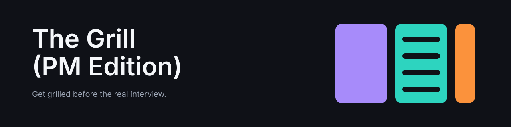

  

**The Grill (PM Edition)** is an open-source AI interviewer for practising product sense interviews. It runs a timed mock interview with hidden scenario facts, pushes back like a real interviewer, and then grades your answer in a separate pass against a published rubric, quoting what you actually said. It is for product managers preparing for interviews, and for anyone who wants honest practice instead of friendly encouragement.

## Try it

- **Web app:** [open The Grill](https://claude.ai/artifact/B9iFzSdxxHZqoypJW85VV3). It needs a Claude account and runs on your own Claude usage.
- **As a Claude skill:** see [Getting started](#getting-started-as-a-claude-skill).

## How a session works

Default session: 25 minutes, timer starts when the scenario appears.

| # | Stage | Budget | What happens |
|---|---|---|---|
| 1 | Scenario | (included) | Scenario shown and read aloud |
| 2 | Clarify | 5 min | Candidate asks clarifying questions; interviewer answers only from hidden facts |
| 3 | Think | 3 min (5 or 8 in practice) | Silent planning with a notepad |
| 4 | Pitch | 8 min | Candidate walks through their answer; interviewer may interrupt once |
| 5 | Pushback | 6 min | Pressure follow-ups according to persona |
| 6 | Wrap | 3 min | Candidate's final summary |
| 7 | Report | after the timer | Separate grading pass, then feedback |

Personas: Friendly, Skeptical and Silent. More in [`docs/session-flow.md`](docs/session-flow.md).

Modes: **Practice** (soft time limits and a stage guide), **Assisted** (suggested answers, marked as assisted in the report), **Exam** (stages end on time) and **Drill** (five minutes on one skill, with an example of a 5 afterwards).

## What makes it different

- **Hidden facts:** each scenario holds facts the interviewer reveals only when asked, so answers stay consistent and good questions are rewarded.
- **A separate, strict grader:** grading is its own pass, and every score cites a verbatim quote from your transcript.
- **Real pushback with personas:** the interviewer challenges your weakest claim, not just a script.
- **Published calibration (planned):** senior PMs will score the same answers, and the results will be public.

## Getting started (as a Claude skill)

1. Download `the-grill-pm-skill.zip` from the latest [Release](../../releases/latest).
2. In Claude, open **Customize → Skills**.
3. Upload the zip.
4. Make sure **Code execution and file creation** is on in **Settings → Capabilities**.
5. Start a chat with: "Grill me on a product sense question".

Note: reading the scenario files first spoils them.

## The rubric

Eight criteria, equal weight, scored 1-5. Full anchors and scoring rules: [`rubric/rubric.md`](rubric/rubric.md).

| Id | Criterion |
|---|---|
| `clarify_goal` | Clarifying the goal and the context |
| `user_segment` | Choosing and justifying a user segment |
| `pain_points` | Finding and prioritising pain points |
| `solutions` | Solution quality and creativity |
| `tradeoffs` | Trade-offs and prioritisation |
| `metrics` | Success metrics |
| `structure` | Structure and communication |
| `pushback` | Handling pushback |

## Repository map

| Folder | Contents |
|---|---|
| `skill/` | The Claude skill (`SKILL.md`) |
| `prompts/` | Interviewer and grader system prompts |
| `rubric/` | Rubric in Markdown and JSON |
| `scenarios/` | Scenario files by domain, plus the schema |
| `docs/` | Session flow and design reference |
| `scripts/` | `validate.py` and `build_skill.py` (Python 3, standard library only) |
| `calibration/` | Planned calibration method and results |
| `artifact/` | Web app source: HTML template and build script |
| `assets/` | Banner and images |

## Calibration

Planned: senior PMs score the same answers; results will be published in [`/calibration`](calibration/README.md).

## Roadmap

- Web app with voice and the VoiceBars interviewer
- More domains: Adtech, Health-tech, Mobility, Developer tools, AI products
- More scenarios
- Calibration results

## Contributing

See [`CONTRIBUTING.md`](CONTRIBUTING.md).

## Author

Built by Tomer Sela, Senior Product Manager and independent product builder · [tomersela.dev](https://tomersela.dev)

## License

MIT. See [`LICENSE`](LICENSE).
